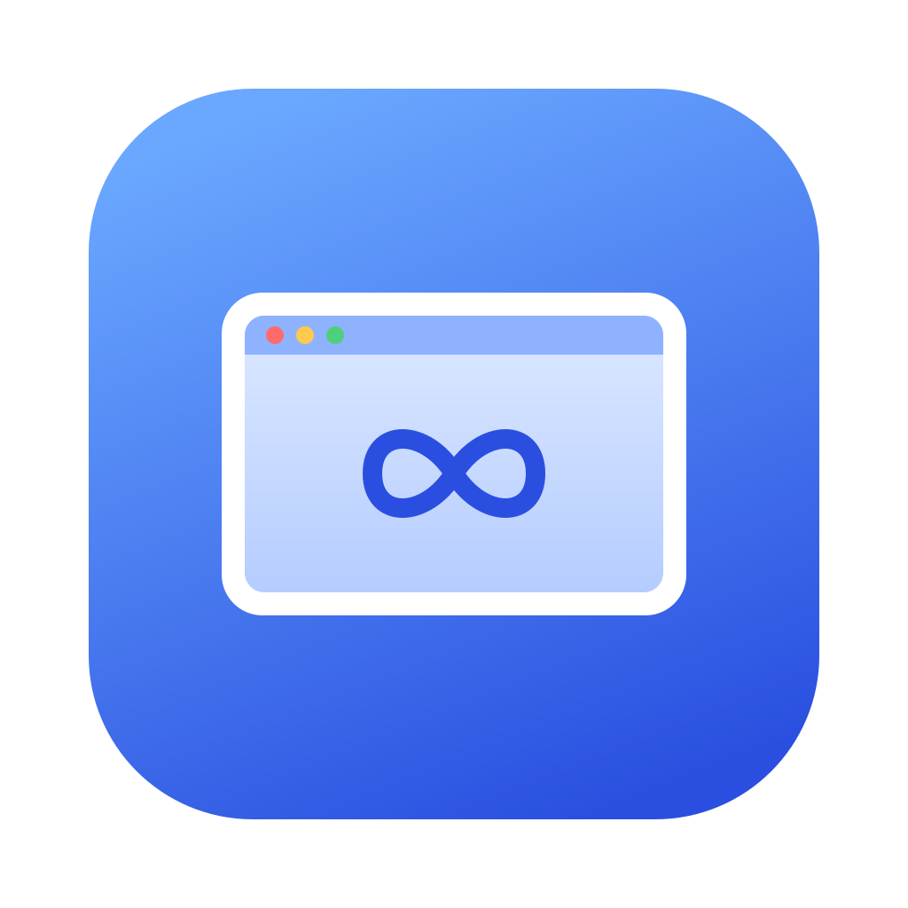

# InfiWindow

InfiWindow 是常驻菜单栏的 Mac 显示器工具箱，让每块屏幕都显示得恰到好处。它目前有两项功能，彼此独立，可以只用其中一项：

- **远程扩展屏**：用 iPad 通过 UU 远程连接 Mac 时，自动加一块和 iPad 分辨率一致的虚拟屏，远程画面铺满 iPad，不留黑边，也不会被拉伸。会话结束后虚拟屏自动移除，显示器排列恢复原样。
- **外接屏 HiDPI**：给 2K 等非 Retina 外接显示器加上 HiDPI 缩放档位，比如在 2560×1440 的屏上“看起来像 1920×1080”，文字和图标更平滑。

用 Go 编写，界面基于 [MyGo](https://github.com/egoist/mygo) 原生 UI（GPU 绘制，没有 WebView），不使用 cgo。

## 功能

窗口左侧是侧边栏：“显示器”页列出所有显示器的排列和状态，每项功能各有一页，另外还有共用的活动记录和设置。

### 远程扩展屏

- **自动检测远程会话**：检测到有人连入就创建虚拟屏，断开后移除。默认监视 UU 远程，被监视的进程名可以改。
- **三种显示方式**
  - **镜像**（默认，推荐）：其他屏幕都镜像虚拟屏。不管 UU 远程采集的是哪块屏幕，iPad 上都能铺满。
  - **主显示器**：虚拟屏成为主显示器（菜单栏和程序坞在上面），其他屏幕保持扩展。
  - **扩展**：只在旁边加一块虚拟屏，需要在 UU 远程里手动切换过去。
- **iPad 型号预设**：Pro 13"/11" (M4)、Pro 12.9"、Air 13"/11"、mini (A17 Pro)，可选横屏或竖屏、60/120 Hz。默认是 iPad Pro 13" (M4)：2752×2064 px，以 Retina 2x 渲染为 1376×1032 pt。
- **缩放**：放大 / 默认（Retina）/ 缩小 / 原生 1:1。所有缩放档位都会注册给 macOS，在“系统设置 → 显示器”里也能直接切换。
- **流量图**：实时显示 UU 进程的上行、下行速率和检测阈值，方便校准。

### 外接屏 HiDPI

- 按显示器的原生分辨率算出 111%–175% 几档缩放（2560×1440 屏上是 2304×1296 到 1464×824），勾选后安装。
- 安装时输入一次管理员密码，重新插拔显示器后生效。之后不需要 InfiWindow 运行。
- 可以在窗口里一键切换档位（原生 1:1、各缩放档、系统自带的 200%），切换时保持当前刷新率；也可以随时移除。

### 通用

- **菜单栏常驻**：没有程序坞图标，关闭窗口只是隐藏。菜单栏里可以看远程扩展屏的状态、手动创建或移除虚拟屏、切换自动模式，或直接打开 HiDPI 页。
- **登录时启动**：设为登录项后在后台启动，不弹出窗口。
- **活动记录**：各项功能做过的操作记在一处，标明来自哪项功能。
- **命令行控制**：可以从脚本或快捷指令操作正在运行的实例：

  ```sh
  /Applications/InfiWindow.app/Contents/MacOS/InfiWindow --create   # 创建远程扩展屏
  /Applications/InfiWindow.app/Contents/MacOS/InfiWindow --remove   # 移除远程扩展屏
  /Applications/InfiWindow.app/Contents/MacOS/InfiWindow --quit     # 退出
  ```

## 原理

### 远程扩展屏

**虚拟显示器**：使用 CoreGraphics 内置的 `CGVirtualDisplay`（macOS 11 起提供，DeskPad、BetterDisplay 也用它），通过 [purego](https://github.com/ebitengine/purego) 从纯 Go 调用 Objective-C 运行时。显示器排列用 `kCGConfigureForSession` 修改，即使程序异常退出，注销后也会还原；进程退出时虚拟屏会随之消失。虚拟屏移除后会把每块屏幕恢复到原来的显示模式（分辨率和刷新率）：镜像结束或屏幕组合变化时，macOS 会按自己存的配置重选模式，内建屏可能换了分辨率，或从 ProMotion 掉到 47.95 Hz。“原来的模式”不是在创建虚拟屏时拍的快照，因为 UU 远程在连接的那一刻就会把内建屏临时改成别的分辨率（比如 1800×1169 @59.94 Hz）。InfiWindow 只在空闲时记录模式：没有会话、没有虚拟屏、上行也低。新模式要在这种状态下保持 10 秒才会被采纳，所以记下的是你自己选的模式。

**会话检测**：UU 远程没有公开 API。InfiWindow 用系统自带的 `nettop`（不需要 root）读取名字以 `UURemote` 开头的进程的网络流量，再用 `lsof` 统计这些进程的对端连接数：

- 上行持续高于**开始阈值**（默认 120 KB/s，持续 2 秒）时，判定为有人连入。只看上行，所以用这台 Mac 去控制别的设备不会触发。
- **断开等待**时间（默认 25 秒）内的平均上行低于**保持阈值**（默认 6 KB/s），且没有多出来的对端连接时，判定为会话结束。用平均值是因为 UU 空闲时也会偶尔冒出 10–20 KB/s 的短暂上行，单看每一秒会让会话一直结束不了。

不同网络和画质下流量差别很大。可以先连一次，对照窗口里的流量图，在“会话检测参数”里调整阈值。被监视的进程名前缀也能改，理论上同样适用于其他远程桌面软件。

### 外接屏 HiDPI

macOS 会读取 `/Library/Displays/Contents/Resources/Overrides/DisplayVendorID-<厂商>/DisplayProductID-<型号>` 里的 `scale-resolutions`，为这台显示器加上对应的 HiDPI 模式。InfiWindow 按显示器原生分辨率算出各档“看起来像”的点数，写成和苹果自带覆盖文件相同的格式（每档 12 字节：宽、高、HiDPI 标志），通过系统授权对话框以管理员身份安装。这个目录不受 SIP 保护。文件里带 `InfiWindowManaged` 标记，InfiWindow 只会替换或删除自己写的文件，手写的或其他工具生成的覆盖文件不会被改动。非整数缩放（如 150%）要把 2 倍渲染的画面缩到 0.75，在 2K 屏上会略软；200%（像素一一对应）macOS 本来就提供。

## 下载

在 [Releases](https://github.com/Infinity4B/infiwindow/releases) 中按芯片选择：`macOS-arm64`（Apple 芯片）、`macOS-amd64`（Intel）或 `macOS-universal`（两者通用）。每次推送到 main 的构建产物也可以在 [Actions](https://github.com/Infinity4B/infiwindow/actions) 的运行记录里下载。

应用是 ad-hoc 签名的。首次打开如果被拦截，请在“系统设置 → 隐私与安全性”中点“仍要打开”，或者执行：

```sh
xattr -dr com.apple.quarantine /Applications/InfiWindow.app
```

## 发布

`.github/workflows/build.yml` 会在每次推送和 PR 时运行检查和测试，并构建三个版本的 macOS 应用。推送 `v*` 标签时还会自动发布 Release。标签必须和 `mygo.json` 里的 `version` 一致：

```sh
# 先把 mygo.json 的 version 改成 0.2.0 并提交
git tag v0.2.0 && git push origin v0.2.0
```

## 构建

需要 Go 1.27+（MyGo 的命令行工具已作为 Go tool 写进 `go.mod`）。

```sh
go tool mygo dev     # 开发模式运行，修改代码后自动重启
go tool mygo build   # 打包到 build/darwin-arm64/InfiWindow.app 和 .dmg
```

测试：

```sh
CGO_ENABLED=0 go test ./...
# 下面这条会在本机真实创建并移除一块虚拟屏：
CGO_ENABLED=0 go test -tags manual -run ManualCreate -v ./internal/display
```

## 目录结构

```
main.go, app.go, tray.go      MyGo 应用：启动、共享状态、菜单栏
view.go                       窗口外框：侧边栏、页面标题
page_*.go                     各页面：显示器概览、远程扩展屏、外接屏 HiDPI、活动记录、设置
internal/display              CoreGraphics（purego）：列出显示器和模式、切换模式、CGVirtualDisplay 虚拟屏与排列
internal/remote               远程扩展屏：检测结果 → 创建/移除虚拟屏的调度，及其设置
internal/remote/detector      nettop/lsof 流量采集与会话状态机
internal/remote/device        iPad 型号预设与分辨率、缩放计算
internal/hidpi                外接屏 HiDPI：覆盖文件的生成、解析、安装与移除
internal/activity             各功能共用的活动记录
internal/config               设置读写，每项功能一节（~/Library/Application Support/InfiWindow/config.json）
```

## 已知限制

- 只支持 macOS 12 及以上（MyGo 的最低要求）。
- `CGVirtualDisplay` 是私有 API，以后的 macOS 版本可能改动它。
- 外接屏 HiDPI 依赖 macOS 的显示器覆盖文件机制。已在 M3 Max + macOS 27 上验证；有报告称 M4/M5 限制了较大的 HiDPI 背板分辨率，某些档位可能不出现。
- 会话检测依赖流量判断。画面长时间完全静止且 UU 不发保活数据时，可能被误判为断开，可以调大“断开等待”时间。
- 应用默认使用 ad-hoc 签名。从其他电脑拷贝过来时，首次打开可能需要在“系统设置 → 隐私与安全性”中允许。
